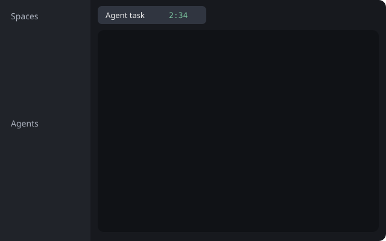

# Herdr Cockpit

You run five coding agents at once. One is stuck on a question, one finished ten minutes ago, and a
pipeline just failed. Which one do you look at first?

Herdr Cockpit is a layout for the [Herdr](https://herdr.dev) desktop app that answers that. It turns
Herdr into a cockpit for agent work: a sidebar with your spaces and agents, a Home panel that says what
needs you now, alerts for merge requests and pipelines, and side panes for tasks, messages, MRs, ports,
usage and diff review.



It's one layout (`layouts/cockpit.json`) and a set of mods (`mods/cockpit-*`), written for Herdr's native
UI toolkit. A small script, `dev.py`, checks them and copies them into Herdr's config folder.

**It started as one person's setup**, built on macOS around GitLab and Jira. Everything else is optional:
a pane whose tool is missing says so and the rest keeps working.

## Quick start

```sh
git clone git@github.com:trihargianto/herdr-cockpit.git
cd herdr-cockpit
cp config.example.json config.json   # then set your Jira site, or leave it
python3 dev.py
```

Herdr switches to the Cockpit layout. Leave `dev.py` running if you want to edit the mods; stop it
with `Ctrl-C` and the layout stays. Check [Requirements](#requirements) first if anything fails.

## What you get

| Where | What it does |
| --- | --- |
| Sidebar, top | **Spaces**: coloured avatars, a status badge per space (needs you, working, done), the repo's branch when it is unusual, `Ctrl+1` to `Ctrl+9` hints. |
| Sidebar, bottom | **Agents**: counts by status that double as filters, sections in order of urgency, each agent's title, time in state, address and branch. |
| Tab bar | Tabs with `Cmd+1` to `Cmd+9` hints, **+** and **Neovim**, then two groups of panel buttons: what needs you (**Home**, **Inbox**, **MRs**, **Tasks**) and tools (**Annotations**, **Agent talk**, **Monitoring**, **Ports**), then a **Panels** menu for the rest. Counters on Inbox, MRs (red when one of your pipelines failed), Tasks, Annotations and Ports. Click a button to open its pane at the top; right-click opens it in the lower half (a short line under the icon marks it). |
| Pane header | Program, folder, branch and the terminal's Herdr address. |
| Status bar | Machine, address, folder, branch; then chips that appear only when they matter: agents that need you, failed pipelines, Herdr errors, an automation due within the hour, quiet mode, Claude's 5-hour limit (amber past 70%, red past 90%), CPU and memory. Each opens the pane behind it. |
| Dock icon | A badge with the agents that need you plus your failed pipelines. |
| Side pane: **Home** | The default pane. Herdr errors, agents that are stuck or finished, MRs waiting for your review, your MRs that are failing, in conflict or running, the tasks you are doing (each with its Jira key, space, agent and MR), your Claude and Codex limits with the next automation, and what you shipped since the last workday or this week, with **Copy standup** (Done, Doing, Blockers as Markdown). The bell turns alerts off (quiet mode). |
| Side pane: **Inbox** | Agents that need you or just finished, with the end of their screen and a reply box. **Other agents** (folded) lists the rest, so you can message any agent from here. |
| Side pane: **Tasks** | A to-do list with Markdown details and links. A task with a Jira key in its title or a Jira link becomes a work item: chips for the Jira card, the space on that branch and the MR with its pipeline. "Send to agent" writes the task as a brief file and sends the agent a one-line pointer. You set the order within a group: drag a card by its header, or `J`/`K`; a task that changes status goes to the top of its new group. Done tasks move to an archive file after a week, or at once with **Archive now**. |
| Side pane: **MRs** | Your open GitLab merge requests and ones waiting for your review, with pipeline state, Retry, Open and Copy link. |
| Side pane: **Projects** | Your project folders. Click one to go to its space; **Start** (or `s`) makes a new space with Agent (Claude), Edit (Neovim) and Runner (a shell) tabs. |
| Side pane: **Monitoring** | Context fullness per agent session, 5-hour and weekly limits for Claude and Codex, and CPU and memory per space and pane. |
| Side pane: **Ports** | Dev servers listening on a port, with their folder and space. Open, copy the URL, or stop one. |
| Side pane: **Review** | Opens [Hunk](https://www.hunk.dev/) on the repo you are in, and lists open Hunk windows. |
| Side pane: **Annotations** | Notes on terminal text, for agents. Select text in any terminal and press `Ctrl+B A` (or right-click › **Annotate selection**), write a comment, `Cmd+Enter` saves. The pane lists the notes of the space you're in, grouped by the terminal they came from. **Send** makes them one message to an agent (the one they came from, the focused one, or one you pick); a busy agent gets it once it's idle. **Paste** puts it in the agent's prompt without sending. Right-click an agent › **Send annotations here** does the same from the terminal. |
| Plannotator reviews | `Ctrl+B o` (or right-click an agent › **Review last reply in Plannotator**) opens the agent's last reply in [Plannotator](https://plannotator.ai) in your browser; `Ctrl+B d` opens the documents of the repo you're in. Comment, then **Approve** or send feedback: it goes to the agent as its next message (waiting if it's busy), or into Annotations when the review didn't start from an agent. For Claude Code the reply comes from its transcript; other agents, from the end of their screen. Needs `plannotator` on your PATH. |
| Side pane: **Agent talk** | Which agents message which. |
| Side pane: **Automations** | Your crontab's jobs: add, edit, turn on and off. |

### Keyboard in panels and the sidebar

Every side panel and both sidebar lists work like a vim buffer once they have the keyboard. They get it
from `Ctrl+B p …`, `Cmd+Shift+H`, `Cmd+I` and `Cmd+G` (open and focus), `Ctrl+B P …` (lower half), or by
moving onto them from a pane with `Ctrl+B h`/`l`, or by clicking anywhere in them. While a panel has the keyboard its title turns accent
and a footer lists its keys; `?` shows them all. The shared rules live in `nav.js`, one copy per mod.

| Key | Everywhere |
| --- | --- |
| `j` `k` (`5j`), `gg` `G` (`3G`), `Ctrl+D` `Ctrl+U` | Move, jump, half a page |
| `Ctrl+H` `Ctrl+J` `Ctrl+K` `Ctrl+L` | To the pane, panel or list on that side (tmux-navigator style) |
| `h`, `Esc` | Back to the terminal |
| `q` | Close the panel (only its half when it's the lower one) |
| `Enter`, `o`, `l` | Open the row |
| `yy`, `dd`, `r` | Copy its link, delete (stop, close), refresh |

| Panel | Its own keys |
| --- | --- |
| Home | `p` peek agent, `c` copy standup, `w` day or week, `m` quiet, `i` `t` Inbox, Tasks |
| Inbox | `i`/`a` reply (`Esc` back to the list), `f` go to agent, `p` peek, `O` other agents |
| MRs | `R` retry pipeline, `f` filters, `D` hide drafts |
| Tasks | `x`/`Space` next status, `J`/`K` move down, up, `a`/`o` quick add, `e` edit, `s` send to agent, `f` filter, `D` done, `A` archive done |
| Ports | `s` go to space, `H` hidden listeners |
| Monitoring | `[` `]` machine |
| Review | `t` beside or new tab |
| Annotations | `s` send, `x`/`Space` mark, `p` paste, `t` who gets them, `e` edit, `yy` copy, `a` all spaces, `u` cancel queued |
| Automations | `a` new, `e` edit, `t`/`Space` on or off, `f` filter |
| Agent talk | `c` clear |
| Spaces | `za` terminals, `r` rename, `n` new space, `dd` close (asks) |
| Agents | `p` peek, `P` pin, `f` filter, `s` space or all |
| Projects | `/` or a click jumps into the filter field at the top (fuzzy on name and path; `Enter` back to the list, `Esc` clears, `↓ ↑ Ctrl+N/P` move while typing), `s` start, `a` add, `x` remove (asks), `dd` remove |
| Quick switcher | `Ctrl+J`/`Ctrl+N` down, `Ctrl+K`/`Ctrl+P` up |

### Alerts

The tab bar polls GitLab every 3 minutes, also while Herdr is in the background, and tells you when one
of your pipelines fails or passes, an MR of yours is approved or gets comments, or someone asks for your
review. In Herdr it is a toast (click it for the MRs pane); with the window in the background it is also
a macOS notification, and a failed pipeline plays Herdr's "needs you" sound. Install `terminal-notifier`
so that clicking the macOS notification opens Herdr: without it the notification is posted by
`osascript`, and macOS opens Script Editor on click. The first poll after a
start only sets the baseline, so nothing old is announced. Quiet mode (`Ctrl+B q` or the bell on Home)
keeps only the Dock badge. Agents that need you are left to Herdr's own alerts.

### Keys

`Cmd+P` opens the quick switcher: spaces, tabs, agents and addresses, and typing a panel's name
("inb", "ports") offers to open it. `Ctrl+B` opens the leader; the next key runs a command or opens a
group, and `?` lists every shortcut. Pressing `Ctrl+B` twice sends a real `Ctrl+B` to the terminal.

| Key | Does |
| --- | --- |
| `Cmd+B` | Sidebar: fold to the rail, or unfold (the rail's » does the same) |
| `Cmd+Shift+H` | Home panel, open and focus |
| `Cmd+I` | Inbox panel, open and focus |
| `Cmd+G` | Review panel, open and focus |
| `Cmd+Shift+J` | Go to the agent that has needed you longest |
| `Cmd+Shift+E` | Side panel, show or hide |
| `Cmd+A` | Select all in the terminal |

| Leader | Does |
| --- | --- |
| `h j k l`, `H J K L` | Focus or swap panes |
| `w`, `t`, `s`, `a` | Pane, tab, space and agent groups |
| `p` then `h i t g o m l p c r a` | Home, Inbox, Tasks, MRs, Ports, Monitoring, Agent talk, Projects, Automations, Review, Annotations: open and focus (`q` inside closes) |
| `P` then `P`, or `h i g o m` | Toggle the lower half, or open that pane in it |
| `g n` | Go to the agent that has needed you longest |
| `g d` | Go to the agent that finished last |
| `g m` | Open the MR for the branch of the pane you are in |
| `g t` | New task (Tasks, with the quick-add field ready) |
| `q` | Quiet mode on or off |
| `A` | Annotate the selected terminal text (or what you copied last) |
| `o` | Review the focused agent's last reply in Plannotator |
| `d` | Review the documents of the repo you're in, in Plannotator |
| `n` | Neovim tab |
| `b`, `B` | Sidebar: rail or full; hide or show it |
| `e` | Side panel, show or hide |
| `f f`, `f p` | Quick switcher, command palette |

## Requirements

Here's what you need before `dev.py` will run:

| Need | Why | Check |
| --- | --- | --- |
| **macOS** | Ports, Monitoring and the status bar use `lsof`, `ps`, `vm_stat` and `sysctl`. Other platforms are untested. | |
| **Herdr** desktop app, opened once (built and tested on 0.1.16) | The layout and mods run inside it | `herdr-app status` |
| `herdr-app` and `hc` on your `PATH` | `dev.py` publishes with `herdr-app`; most panes read agents and terminals with `hc` (Herdr Core). Both come with Herdr. | `which herdr-app hc` |
| **Python 3.8+** | Runs `dev.py` | `python3 --version` |
| `git` | Branch labels in Spaces, repo detection, the Review pane | `git --version` |

**Optional.** Each one lights up a pane or a feature. Leave out what you don't use:

| Tool | Gives you | Install |
| --- | --- | --- |
| `glab`, signed in | The **MRs** pane, MR and pipeline alerts, merged MRs on Home | `brew install glab`, then `glab auth login` |
| `terminal-notifier` | macOS notifications that open Herdr when clicked | `brew install terminal-notifier` |
| `hunk` | The **Review** pane | [hunk.dev](https://www.hunk.dev/) |
| `nvim` | The **Neovim** button and the Edit tab of a new project | `brew install neovim` |
| `claude` (Claude Code) | The Agent tab of a new project, limits in **Monitoring** and the status bar | [claude.com/claude-code](https://claude.com/claude-code) |
| Codex | Its limits in **Monitoring** | |
| `crontab` | The **Automations** pane (built into macOS) | `crontab -l` |
| A Jira site | Jira keys in tasks become links | set `jiraUrl` in `config.json` |
| `plannotator` | Plannotator reviews (`Ctrl+B o`, `Ctrl+B d`) | [plannotator.ai](https://plannotator.ai) |
| Node.js 18+ | Only to run the tests | `node --version` |

**Monitoring reads limits from the agent's screen.** It needs Claude Code's status line to print
`Context … Usage … Weekly …`. With a different status line the limits stay empty; everything else works.

## Install

### 1. Get the code

```sh
git clone git@github.com:trihargianto/herdr-cockpit.git
cd herdr-cockpit
```

### 2. Add your settings

```sh
cp config.example.json config.json
```

`config.json` is git-ignored, so your settings stay yours:

```json
{
  "jiraUrl": "https://your-team.atlassian.net"
}
```

`jiraUrl` is your Jira site, without `/browse`. Remove the line, or skip the file, if you don't use
Jira: keys like `ABC-123` still show on tasks, just without a link.

### 3. Publish

```sh
python3 dev.py
```

`dev.py`:
1. runs `herdr-app check` on every mod that changed, and refuses to publish one that fails;
2. copies `layouts/`, `mods/` and your `config.json` into `~/.config/herdr-app/`;
3. merges `keybindings.json` into Herdr's `keys.json` (only the keys listed there);
4. switches Herdr to the `cockpit` layout;
5. keeps watching the folder and republishes whenever you save a file.

Press `Ctrl-C` to stop watching: the layout stays installed. To publish once and exit, run
`python3 dev.py --once`.

**`dev.py` never overwrites a file it didn't put there.** It records what it published in
`.published.json`, and stops with a message if another file is in the way.

### 4. First look

- Open **Home** with `Cmd+Shift+H`: what needs you now.
- Press `Ctrl+B` then `?` for every shortcut.
- If you use GitLab, MRs show up on the next poll (every 3 minutes), or at once with `r` in the MRs pane.

## Configure

Most of it works as soon as it is installed. These are the places to adjust things.

**Layout.** `layouts/cockpit.json`: sidebar width (`sidebar`, 232 px), tab bar and title bar height
(44 px), pane gaps and corner radius, and the side panel's width (`panel`, 320 px). The side panes
are the children of the `panel-body` stack. The lower half is the `panel-lower` stack, hidden until
you open a pane there; its blocks are second copies of five read-only panes (Home, Inbox, MRs, Ports, Monitoring), with
`"props": { "slot": "lower" }`. Tasks is left out: two copies would save over each other.

**Jira.** Set `jiraUrl` in `config.json` (see [Install](#2-add-your-settings)); `dev.py` publishes it to
`~/.config/herdr-app/cockpit/config.json`, where Home and Tasks read it when they start. Keys are upper
case (`ABC-123`), found in a task's title, a Jira link, or a branch name.

**Shortcuts.** `keybindings.json` holds the Cockpit keys; edit it and `dev.py` merges the change into
Herdr's `keys.json`.

**Colours and fonts.** These come from your Herdr theme (Settings in Herdr, or `settings.json`). The
mods only use theme colours, so a different theme changes everything.

**Key hints.** The `Cmd+1` and `Ctrl+1` hints are read from your `keys.json`, so they match your
real bindings.

**Where things are saved.**

| What | Where |
| --- | --- |
| Tasks | `~/.config/herdr-app/cockpit-tasks/tasks.json` |
| Archived tasks | `~/.config/herdr-app/cockpit-tasks/tasks-archive.json` |
| Briefs sent to agents | `~/.config/herdr-app/cockpit-tasks/briefs/` |
| Small per-pane settings (Space or All, folded sections, where Hunk opens) | each pane's own local storage, inside Herdr |

**Polling.** Every redraw repaints the whole Herdr window, so the mods poll gently. Side panes refresh
only while they are the pane shown, and mostly only while the Herdr window is in front. The tab bar
runs the rest, in `mods/cockpit-tabs/feed.js`, and shares what it finds with the other mods
(`cockpit.mrs`, `cockpit.limits`, `cockpit.next`, `cockpit.errors`):

| What | How often |
| --- | --- |
| Merge requests (`glab`, at most 4 at once) | every 3 minutes, also in the background for alerts; every 2 minutes while the MRs pane is shown |
| Claude and Codex limits (`hc read`) | every minute |
| Crontab | every 5 minutes |
| `herdr-app status` | every minute |
| Ports counter (`lsof`) | every 30 s; while the Ports pane is shown, the pane's own scan is reused |
| Tasks counter | every 5 s |
| CPU and memory in the status bar (`ps`, `vm_stat`) | every 5 s, window in front |

The intervals are constants at the top of `feed.js` and in each mod's `init`.

## How the panes find your repo

A pane looks at the terminal you last focused and uses the folder that terminal's pane reports
(`panes()` in Herdr's API), which follows `cd`. It then asks git for the repository root. Herdr's
terminal list and a space's stored folder only record where something started, so they are not used.

## Layout of this repository

| Path | What it is |
| --- | --- |
| `layouts/cockpit.json` | Window structure, sizes, pane frames, the side panel's two stacks |
| `layouts/cockpit.svg` | The preview Herdr's settings screen shows |
| `mods/cockpit-tabs` | Tab bar, panel buttons, counters, Neovim button, and the feed (`feed.js`, `feedlib.js`) |
| `mods/cockpit-home` | Home pane; `work.js` joins a task to its Jira card, branch, agent and MR |
| `mods/cockpit-spaces`, `cockpit-dashboard` | Sidebar: spaces list and agents panel |
| `mods/cockpit-pane` | Pane headers |
| `mods/cockpit-workspace-chrome`, `cockpit-workspace-status` | Sidebar top row and footer; status bar |
| `mods/cockpit-leader`, `cockpit-picker`, `cockpit-panel-menu` | `Ctrl+B` leader, `Cmd+P` switcher, the Panels menu |
| `mods/cockpit-annotate` | Annotations: the note dialog and the side pane. `annolib.js` (also in `cockpit-tabs`, which captures selections, sends the queue and runs Plannotator reviews) holds the note format and message |
| `mods/cockpit-menu` | The terminal right-click menu: Herdr's items plus Annotate, Send annotations here and Review last reply |
| `mods/cockpit-inbox`, `cockpit-tasks`, `cockpit-mrs`, `cockpit-projects`, `cockpit-usage`, `cockpit-ports`, `cockpit-review`, `cockpit-talk`, `cockpit-automations` | The other side panes |
| `mods/agenttrail` | The Agenttrail Map. Not used by the layout; Agent talk borrows its look. |
| `tests/` | Unit tests for the feed, work items, the task report, Automations and annotations |
| `dev.py` | Checks and publishes to Herdr, watches for edits, and uninstalls |
| `config.example.json` | The settings template; copy it to `config.json` |
| `keybindings.json` | Cockpit's shortcuts, merged into Herdr's `keys.json` |
| `AGENTS.md`, `DESIGN.md` | Notes for coding agents and the design rules used here |

Herdr writes `gpui-kit.d.ts` and `jsconfig.json` into every mod folder so editors can complete the
API. They are generated, so they are not in git.

## Develop

1. Edit a mod or the layout in this folder, never in `~/.config/herdr-app/`.
2. With `dev.py` running, a save is checked and published within a second or two. A mod that fails
   `herdr-app check` is not published, and the reason is printed.
3. `herdr-app status` shows errors from files and mods. `herdr-app shot file.png` saves a screenshot
   of the window, which helps when adjusting spacing.

Note that `herdr-app check` renders only a mod's first, empty state. A mod can pass it and still
fail once real data arrives, so open the pane in Herdr after changing it.

Run the tests (no Herdr needed):

```sh
node --test tests/*.mjs
python3 -m unittest tests/test_automations.py
```

`nav.js` is copied into every mod that uses it (mods can't import each other), and `work.js` into Home
and Tasks. Edit one copy, copy it to the others; a test fails if they differ.

## Troubleshooting

| You see | Do this |
| --- | --- |
| `herdr-app isn't on your PATH` | Open Herdr once, then check `which herdr-app`. It lives in `~/.local/bin`; add that to your `PATH`. |
| `Conflicting file; preserve or move it first` | A file `dev.py` wants to write already exists in `~/.config/herdr-app/` and isn't one it published. Move it away, or keep it and delete the matching file here. |
| `Not published: ... check ...` | A mod failed `herdr-app check`. The error names the line. The last good version keeps running. |
| A pane says "This view could not be re-rendered" | Run `herdr-app status` for the error, then fix and save. |
| MRs says `glab` isn't installed or signed in | `brew install glab`, then `glab auth login`. |
| Clicking a macOS notification opens Script Editor | `brew install terminal-notifier`. |
| Jira keys aren't links | Set `jiraUrl` in `config.json` and restart `dev.py` (it publishes `config.json` at start and on save). |
| Monitoring shows no limits | Claude Code's status line must print `Context … Usage … Weekly …`. |
| Spaces keeps asking about a machine | `herdr-app status` lists unreachable machines; remove or fold the ones you no longer use. |

## Switch back or uninstall

Return to Herdr's own layout at any time:

```sh
herdr-app do layout.switch '{"name":"main"}'
```

To remove Cockpit completely, stop `dev.py`, then run:

```sh
python3 dev.py --uninstall
```

It switches Herdr back to its own layout, deletes what it published (the `cockpit` layout, the
`cockpit-*` mods, your published `config.json`) and takes its shortcuts out of `keys.json`. A file you
changed inside Herdr since is kept, and listed. Your tasks stay in `~/.config/herdr-app/cockpit-tasks/`
unless you delete that folder too.

## Back up

The whole layout is this repository, plus your `config.json`. Your tasks live outside it, in
`~/.config/herdr-app/cockpit-tasks/`, so copy that folder separately if you want them kept.

**Takeaway:** clone, copy `config.json`, run `python3 dev.py`. Add `glab` and `terminal-notifier` when
you want MRs and alerts.

## Credits and licence

[MIT](LICENSE), with one exception. The layout and five mods (spaces, tabs, pane header, chrome,
status bar) began as copies of Herdr's shipped mods, which are under the
[Apache License 2.0](LICENSES/Apache-2.0.txt). Their Herdr-derived parts stay under that licence.
[NOTICE](NOTICE) lists which files they are.
